# Olá! Eu sou Gustavo Alexander 👋

🎓 Estudante de Engenharia de Software na UNICID.

💻 Estou desenvolvendo meus conhecimentos em programação e tecnologia.

## 🚀 Sobre mim

- 📚 Estudando Engenharia de Software.
- 🐍 Aprendendo Python.
- 💻 Conhecimentos em programação C.
- 🌐 Estudando HTML e CSS.
- 🗄️ Aprendendo banco de dados e SQL.
- 🔧 Conhecendo Git e GitHub.

## 🛠️ Tecnologias e ferramentas

- C
- Python
- HTML
- CSS
- SQL
- Git
- GitHub

## 📂 Projetos

Aqui compartilho alguns projetos acadêmicos e exercícios desenvolvidos durante minha jornada de aprendizado.

## 🎯 Objetivo

Continuar aprendendo, desenvolver projetos e conquistar minha primeira oportunidade na área de tecnologia.
